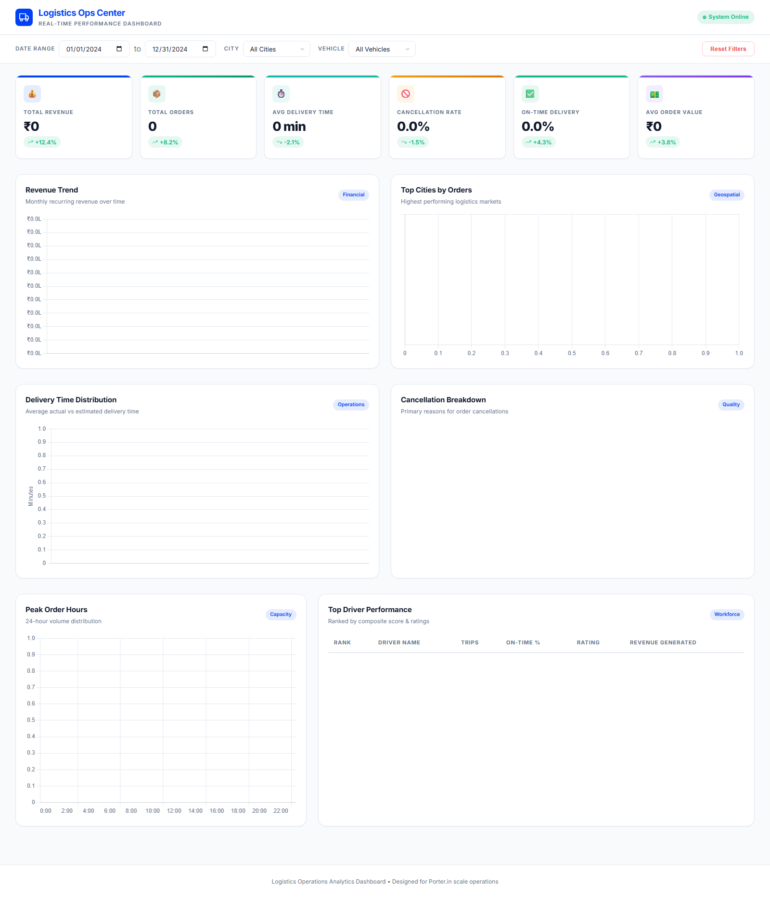
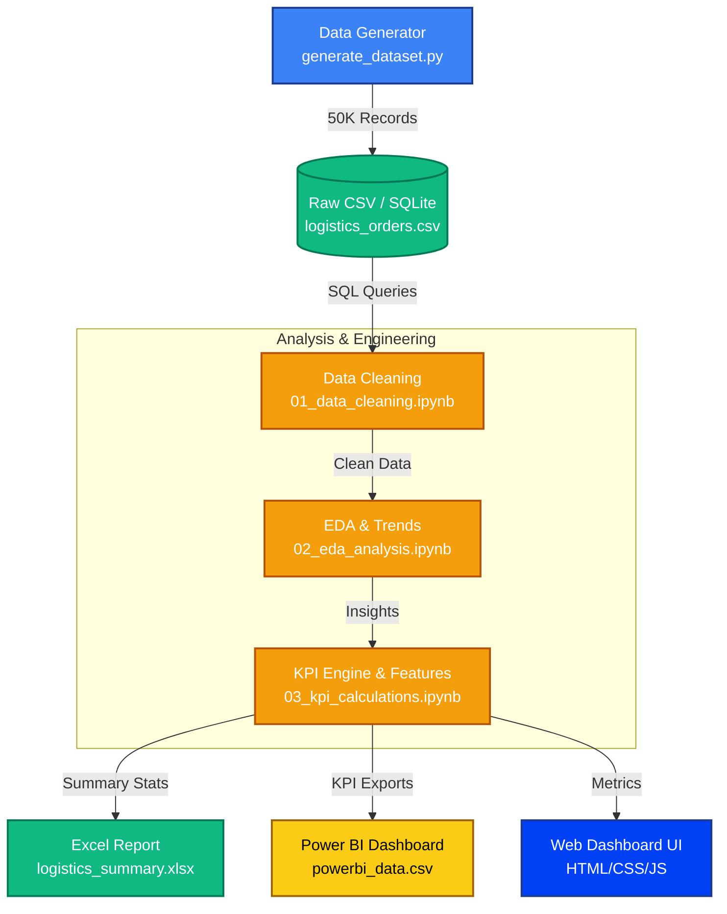

# Logistics Operations Analytics Dashboard

An end-to-end analytics project simulating a modern logistics company's data ecosystem, featuring a synthetic dataset, SQL analysis, Python EDA, Power BI, and a custom Porter.in-inspired web dashboard.

## 🚀 Project Overview



This repository contains a full-stack data analytics solution to monitor, analyze, and optimize delivery operations across 25 Indian cities. It covers everything from raw data generation to interactive visualizations.

### Core Features

- **Data Engineering**: Python/Faker script generating 50,000 realistic delivery records with seasonal trends, peak-hour distributions, and realistic delivery delays.
- **Data Analytics (SQL)**: 15 production-grade SQL queries including driver ranking, customer segmentation, SLA monitoring, and MoM financial growth.
- **Exploratory Data Analysis (Python)**: 3 Jupyter notebooks covering data cleaning, deep EDA with 15+ Matplotlib/Seaborn charts, and comprehensive KPI feature engineering.
- **Reporting (Excel & Power BI)**: An automated, styled Excel summary workbook and a complete build guide + DAX library for Power BI.
- **Interactive Dashboard (Web)**: A premium, dark-mode web dashboard built with HTML/CSS/JS (Chart.js) featuring animated KPIs, glassmorphism, and live filtering.

---

## 🏗️ System Architecture



## 📁 Repository Structure

```text
Logistics/
├── data/          # Synthetic datasets, generators, and data dictionaries
├── sql/           # DDL schemas and 15+ analytical SQL queries
├── notebooks/     # Jupyter notebooks for Cleaning, EDA, and Feature Engineering
├── excel/         # Formatted KPI summary workbooks
├── powerbi/       # DAX measures and Power BI build instructions
├── assets/        # Screenshots and brand assets
└── dashboard/     # Custom Porter.in-inspired interactive web dashboard
```

---

## 🛠️ Setup & Execution

### 1. Requirements

- Python 3.8+
- Required packages: `pandas`, `numpy`, `matplotlib`, `seaborn`, `openpyxl`, `jupyter`

```bash
pip install pandas numpy matplotlib seaborn openpyxl jupyter
```

### 2. Generating the Dataset

If you want to regenerate the synthetic dataset with different parameters (or if `logistics_orders.csv` is missing):

```bash
cd data
python generate_dataset.py
```

### 3. Running Notebooks

Start Jupyter to view the analysis notebooks:

```bash
jupyter notebook
```
Execute them in sequence: `01` ➔ `02` ➔ `03`. The `03_kpi_calculations.ipynb` notebook will generate the Excel workbook and Power BI CSV.

### 4. Viewing the Web Dashboard

To view the interactive HTML dashboard, start a local HTTP server (needed to bypass CORS issues when loading local CSV files via JS):

```bash
# From the root Logistics directory
python -m http.server 8000
```
Then navigate to: `http://localhost:8000/dashboard/`

### 5. Building the Power BI Dashboard

1. Open Power BI Desktop.
2. Follow the instructions in `powerbi/powerbi_guide.md` to import data, set up the data model, and import the custom dark theme.
3. Use the DAX formulas in `powerbi/dax_measures.md` to create the required measures.

---

## 📊 Key Insights Sample

Based on the default 50K generated records:
- **Peak Order Volume** occurs during 12:00-14:00 (Lunch) and 19:00-21:00 (Dinner).
- **Highest Cancellation Rates** are associated with 'Bike' vehicle types during weekend peak hours.
- **Top Markets**: Mumbai, Delhi, and Bangalore account for over 35% of total logistics revenue.
- **Customer Retention**: Around 15-20% of the customer base makes up the "Regular" and "Loyal" segments, contributing disproportionately to lifetime value.

---

*Designed and implemented as a Senior Data Engineering & Analytics portfolio piece.*
